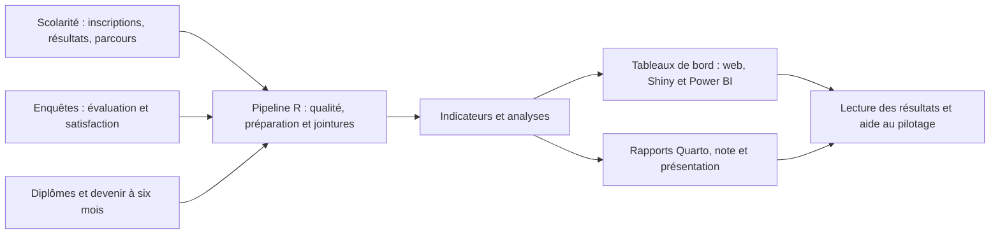

# Observatoire statistique des parcours et de la réussite universitaire

Démonstrateur professionnel en R, inspiré d'une mission universitaire UPEC / DEVE / SPOF. Aucune affiliation officielle ni donnée réelle de l'UPEC. Toutes les données individuelles sont synthétiques.

Périmètre : 15 000 étudiants fictifs générés sur 2023-2024 à 2025-2026 (et non 15 000 par année), cinq formations fictives. Une inscription principale par étudiant et année. Après quarantaine, 14 998 personnes ont au moins une inscription exploitable, soit 24 217 inscriptions annuelles.

## Contexte professionnel et question centrale

Dans le scénario simulé, un responsable du SPOF confie à un chargé d’études la conception d’un observatoire permettant de suivre les inscriptions, la réussite, les réorientations, l’évaluation des formations et le devenir des diplômés. La mission couvre toute la chaîne, de la fiabilisation des données à la restitution aux responsables de formation.

**Comment exploiter les données de scolarité et les enquêtes étudiantes pour comprendre les parcours universitaires, évaluer les formations et éclairer le pilotage de l’offre de formation ?**

Le démonstrateur poursuit quatre objectifs métier :

- Suivre les effectifs, la validation et les transitions dans le temps.
- Analyser les avis étudiants en tenant compte de la participation et de la non-réponse.
- Décrire le devenir des diplômés lorsque l’horizon d’observation est atteint.
- Produire des indicateurs traçables et des restitutions pouvant illustrer une démarche d’autoévaluation des formations.

Les recommandations restent des illustrations méthodologiques sur données fictives. Elles ne constituent ni une évaluation officielle des formations, ni une validation institutionnelle.

## Architecture fonctionnelle



Les calculs statistiques sont réalisés en R. Python intervient dans l’assemblage des livrables web et la validation des schémas Power BI. L’actualisation locale est documentée ; aucun rafraîchissement distant n’est annoncé.

## Données simulées

| Table | Contenu et rôle |
|---|---|
| `etudiants.csv` | Identifiants entièrement synthétiques, caractéristiques et profils |
| `formations.csv` | Référentiel des cinq formations et composantes fictives |
| `inscriptions.csv` | Inscriptions principales par année, formation, niveau et régime |
| `resultats.csv` | Validation annuelle, résultats connus ou inconnus et crédits ECTS |
| `parcours.csv` | Passage, redoublement, réorientation, sortie documentée, situation inconnue et censure |
| `evaluation.csv` | Sollicitations et réponses aux enquêtes d’évaluation, dont les avis de satisfaction |
| `diplomes.csv` | Diplômes obtenus et dates de diplomation |
| `insertion.csv` | Éligibilité à l’enquête et situation déclarée des diplômés |

Le générateur représente des trajectoires sur plusieurs années, des manquants et des réponses partielles. Une copie dégradée contient des anomalies contrôlées, dont des doublons, afin de tester la qualité et la traçabilité des corrections. **Une absence de réinscription n’est pas assimilée à un abandon définitif.**

Les définitions détaillées restent centralisées dans le [dictionnaire des données](docs/03_dictionnaire_donnees.md), le [dictionnaire des indicateurs](docs/04_dictionnaire_indicateurs.md) et le [protocole statistique](docs/02_protocole_statistique.md).

## Site de présentation Quarto

Le site classique est intégré au dépôt : accueil, projet, tableaux de bord,
rapport final en treize chapitres et téléchargements.

```bash
quarto render
quarto preview
```

Le résultat se trouve dans `_site/index.html`. Les consignes de construction
et d’hébergement sont dans [docs/18_site_quarto.md](docs/18_site_quarto.md).

## Commencer

1. Ouvrir le dossier racine dans **VS Code** (`code .`) et installer les extensions recommandées R et Quarto. Le fichier `.Rproj` existant reste facultatif pour les utilisateurs de RStudio.
2. Lire [la fiche d’identité](docs/00_fiche_identite.md), [le cadrage](notebooks/00_cadrage_du_projet.qmd) et [le guide d’architecture VS Code](docs/19_architecture_vscode.md). Les prompts historiques servent à rejouer les phases ; ils ne sont pas nécessaires au démarrage.
3. Sur une nouvelle machine, lancer la tâche **Observatoire : restaurer renv** pour retrouver les versions de `renv.lock`. L’accès au réseau et au cache peut être nécessaire. `01_bootstrap.R` est réservé à une initialisation ou à une mise à jour explicite.
4. Lancer les tâches **vérifier l’environnement R**, **exécuter le pipeline targets** et **exécuter les tests R**, dans cet ordre. Les commandes équivalentes sont documentées dans le guide VS Code.
5. Après préparation des ressources web, lancer **rendre le site Quarto**, puis **prévisualiser le site Quarto**. Le lanceur transmet automatiquement le chemin R à Quarto. Voir [les prérequis du site](docs/18_site_quarto.md).
6. Pour les PDF, `scripts/export_pdf.ps1` réutilise les HTML autonomes de `outputs/reports/reports/` et exige Python 3 et Chrome/Edge. Le rendu du site n’actualise pas automatiquement ces PDF. Python sert aussi aux assembleurs web, mais n’intervient pas dans le calcul statistique R.

Le pipeline R est autonome et n'utilise ni Python ni Power BI pour calculer les statistiques. Pour rejouer pédagogiquement une phase : `Rscript --vanilla scripts/run_phase.R 2`, puis 3 à 8, une commande à la fois. Les recettes précédentes sont requises. La phase 7 teste une modification de graine puis restaure le fichier et les données ; la phase 8 exécute les tests et rend les rapports.

## État au 21 octobre 2026

La [vérification des 37 étapes](docs/21_verification_37_etapes.md) distingue présence, équivalence et preuve d’exécution : 34 étapes validées ou adaptées, deux partielles, une publication GitHub non réalisée. La validation actuelle ne certifie pas une chronologie historique exacte en 37 opérations.

**Audit final : [89/100](docs/22_audit_final.md), validation technique locale réussie.** Le pipeline a été recalculé ; **104 assertions R passent**, dont 30 pour Shiny, sans échec, avertissement de test ou test ignoré. L’audit lintr ne signale aucune observation sur `R/`. Les 79 schémas Power BI sont validés avec des dépendances Python figées. Les rapports, les 18 notebooks et le site Quarto sont rendus ; les PDF sont régénérés. `renv::status()` est cohérent, et les six exports protégés sont strictement identiques avant/après correction. Voir [la validation technique détaillée](docs/23_validation_technique.md) et [les corrections](docs/25_corrections_validation.md).

Les recettes des huit jalons initiaux sont conservées dans [docs/recettes](docs/recettes). La même graine produit des objets identiques ; les contrôles historiques de reprise et de changement/restauration de graine y restent identifiables.

| Phase | Résultat |
|---|---|
| 1 | environnement renv et cadrage vérifiés |
| 2 | huit tables générées, dictionnaire complet et intégrité contrôlée |
| 3 | 12 injections repérées, journal, quarantaine et tables préparées |
| 4 | effectifs, validation, diplôme, transitions, cohortes et figure calculés |
| 5 | questionnaires, non-réponse, satisfaction et insertion à six mois analysés |
| 6 | modèle logistique, diagnostics, évaluation séparée et sensibilité produits |
| 7 | pipeline et exports protégés validés ; projet Power BI PBIP de trois pages généré et ouvert ; 126 comparaisons R/DAX réussies dans Desktop |
| 8 | rapport, note, présentation et enquête rendus ; publication GitHub non effectuée |

Résultats **fictifs** 2025-2026 : 10 222 inscrits préparés, 7 478 validations connues sur tous les inscrits (73,2 %), 288 résultats inconnus. Le modèle initial a une AUC d'environ 0,607 : discrimination limitée, aucune utilisation individuelle ou inférence causale. Les paramètres de simulation expliquent ces résultats, sans portée empirique sur l'UPEC.

## Livrables à ouvrir

- **[Ouvrir la page du site](_site/index.html)** : présentation du projet, tableaux de bord, rapports Quarto et téléchargements.
- **[Rapport final à treize chapitres](_site/rapport_final.html)**. Accès et vérifications documentés dans [le guide du site](docs/17_site_presentation.md).

- **[Tableau de bord Power BI natif](dashboards/powerbi/Observatoire/Observatoire.pbip)** : trois pages déjà construites ; [guide d'ouverture](dashboards/powerbi/README.md). Modèle et schémas vérifiés, 126 comparaisons R/DAX réussies dans Desktop. Livrable PBIP, aucune publication dans le service Power BI.

- **[Application R Shiny](dashboards/shiny/README.md)** : lancer `source("scripts/run_shiny.R")` depuis la racine, puis ouvrir `http://127.0.0.1:3839`.

- [Tableau de bord interactif local](dashboards/interactive/dist/index.html) : filtres année/formation, cartes, graphiques et huit fiches méthodologiques. Actualiser ses données protégées avec `python scripts/build_dashboard_data.py` après exécution du pipeline R.
- [Tableau de bord intégré au site](_site/tableaux_de_bord.html) et [version pleine page](_site/dashboard/index.html).
- [Fiche pour maîtriser les indicateurs](docs/13_maitriser_les_indicateurs.md) : formules, exemples chiffrés et points de vigilance.

- [Rapport final HTML](outputs/reports/reports/rapport_final.html) et [PDF](outputs/reports/reports/rapport_final.pdf).
- [Note de pilotage HTML](outputs/reports/reports/note_pilotage.html) et [PDF](outputs/reports/reports/note_pilotage.pdf).
- [Présentation de dix minutes](outputs/reports/reports/presentation.html).
- [Rapport d'enquêtes](outputs/reports/reports/enquetes.html).
- [Guide Power BI, requêtes et mesures](dashboards/powerbi/README.md).
- [Méthodologie du modèle](docs/09_methodologie_modeles.md), [préparation de l'entretien](docs/10_entretien.md) et [publication locale](docs/11_publication.md).

Git local initialisé ; R 4.6.1 et Quarto 1.10.18 utilisés. Power BI Desktop a ouvert le projet et exécuté l'actualisation ainsi que la recette DAX ; l'inspection exhaustive du canvas n'est pas revendiquée. Les matrices LimeSurvey sont des supports de transposition non importés. Le livrable Power BI est un PBIP, sans publication dans le service ni rafraîchissement distant. Les quatre rapports Quarto ont été actualisés lors de la publication du site ; le rapport final suit désormais le plan demandé en treize chapitres.

Vérification : `source("scripts/02_verify_setup.R")`. R émet actuellement des avertissements au démarrage sur la locale `C.UTF-8` et utilise la locale `C` ; vérifier les tris et les dates avant les analyses. Les fichiers du projet sont écrits en UTF-8.

## Organisation

`R/` : fonctions de traitement ; `scripts/` : commandes d'exécution ; `config/` : paramètres et définitions ; `data/` : sources, copies dégradées et données préparées ; `tests/testthat/` : contrôles statistiques ; `notebooks/` : exploration ; `surveys/` : questionnaire et protocole ; `dashboards/powerbi/` : modèle et mesures ; `reports/` : sources Quarto ; `outputs/` : livrables calculés ; `docs/` : méthode et recette ; `prompts/` : consignes réutilisables.

Les données générées et les sorties sont ignorées par Git par défaut. Une publication éventuelle fera l'objet d'une sélection explicite. Aucun dépôt distant n'est encore créé. L’[architecture documentée](docs/19_architecture_vscode.md) distingue sources, données régénérables et livrables. La [revue de cohérence](docs/20_revue_cadrage_architecture.md) indique les compléments apportés et les doublons évités.
