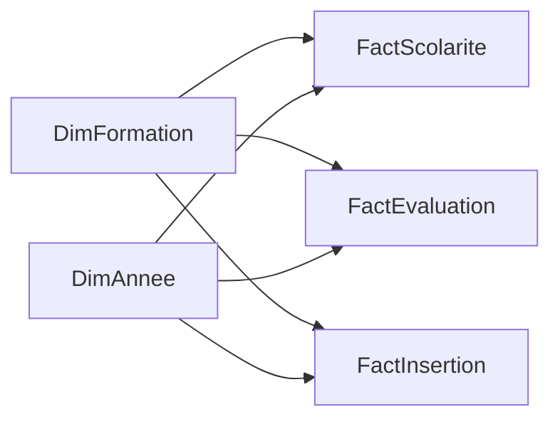

# Tableau de bord Power BI — projet natif

**Données entièrement fictives. Aucun chiffre de l'UPEC.** Un projet Power BI natif est maintenant généré : [ouvrir Observatoire.pbip](Observatoire/Observatoire.pbip). Les pages sont déjà construites ; les instructions de montage manuel plus bas restent disponibles comme documentation technique.

## Ouvrir le tableau de bord

1. Double-cliquer sur `Observatoire/Observatoire.pbip` avec Power BI Desktop, en conservant les deux dossiers `Observatoire.Report` et `Observatoire.SemanticModel` ainsi que `Data` à côté du fichier.
2. Si les données ne sont pas chargées, cliquer sur **Accueil → Actualiser**. Le paramètre Power Query `DossierExports` désigne le dossier `Observatoire/Data/` de ce poste ; le modifier en cas de déplacement du projet.
3. Utiliser les listes année et formation. L'année 2025-2026 est sélectionnée par défaut. Les filtres sont synchronisés entre synthèse et parcours. Le graphique de validation conserve les trois années grâce à une dimension d'axe indépendante, tout en appliquant la formation sélectionnée.
4. Naviguer avec les onglets de pages, ou Ctrl+clic sur les boutons de navigation en mode édition de Desktop.
5. Pour un fichier `.pbix`, utiliser **Fichier → Enregistrer sous** dans Desktop. Le livrable généré ici est un `.pbip`, pas un fichier PBIX renommé.

Pages livrées : **Vue d'ensemble**, **Parcours & devenir**, **Indicateurs & méthode**. Même palette verte que les versions HTML et Shiny ; quatre cartes principales, évolution de la validation, couverture, participation, évolution des effectifs et huit fiches de définition. Les pages détaillées du plan initial ci-dessous sont regroupées dans ces trois pages.

## Recette exécutée

79 fichiers validés contre les schémas publics Microsoft, zéro erreur de schéma. Le modèle TMSL est accepté par la bibliothèque Tabular Object Model de Desktop : sept tables, six relations et 35 mesures. Le projet a été ouvert dans Power BI Desktop 2.146 ; l'actualisation des CSV protégés a réussi.

**126 comparaisons R/DAX exécutées dans le moteur Desktop : zéro écart**, y compris filtres toutes formations, chaque formation et une sélection de deux ; NA et masques sont bien conservés. La matrice `outputs/tables/recette_filtres_powerbi.csv` porte le statut `VALIDE_MOTEUR_DESKTOP`. Cette recette valide les calculs du moteur, pas une inspection exhaustive du rendu et de chaque interaction graphique de Desktop. Aucune publication dans le service Power BI.

Pour régénérer les sources : `python scripts/build_powerbi_project.py`. Pour vérifier les schémas : `python scripts/validate_powerbi_project.py` (dépendance de QA `jsonschema` dans `outputs/powerbi-qa/python`). Pour la recette moteur, ouvrir le projet puis exécuter `scripts/verify_powerbi_engine.ps1`. Ces contrôles requièrent Power BI Desktop et l'accès local à son instance Analysis Services.

## Importer et relier

1. Exécuter `scripts/run_pipeline.R` depuis R à la racine.
2. Ouvrir un rapport vide dans Desktop. Créer un paramètre texte `DossierExports` pointant vers le chemin absolu de `outputs/exports/powerbi/` avec séparateur final `/`.
3. Créer une requête vide `fxCsv` à partir de `fxCsv.pq`, puis les cinq requêtes du fichier `requetes.md`. Désactiver le chargement de la fonction et du paramètre.
4. Déclarer `DimFormation[formation_id]` et `DimAnnee[annee]` comme côtés 1, reliés aux colonnes homologues de chaque table de faits côté N. Filtrage **simple des dimensions vers les faits** ; aucune relation entre faits. Trier année par ordre. Une seule ligne formation–année par fait.
5. Ajouter les mesures de `mesures.dax` une par une. Désactiver la synthèse implicite des colonnes de comptes et masquer ces colonnes dans la vue rapport. Utiliser les mesures explicites ; le paquet ne contient pas d'identifiants étudiants.

## Correspondance avec le plan initial des pages

Format 16:9, fond clair, bandeau permanent « Démonstration — données entièrement fictives », clôture 30/09/2026, filtres synchronisés année et formation (cycle/composante possibles depuis la dimension).

| Page | Cartes | Visuels et précautions |
|---|---|---|
| Inscriptions | Inscrits, Évolution | courbe d'inscrits par année, barres formation ; une année requise pour la carte de personnes distinctes |
| Réussite | Validation éligibles, Couverture, Validation connus, Diplomation | matrice formation × année ; expliquer la borne basse/haute en cas de manque |
| Parcours | Passage, Réorientation, Sortie observée, Inconnus | barres de transition ; dernier millésime sans taux de suivi futur ; fin de cycle diplômée séparée |
| Enquêtes | Participation, Satisfaction, Couverture avis | barres des participations, avis valides ; aucune assimilation sans avis/insatisfaction |
| Insertion | Éligibles, Participation insertion, Emploi, Insertion actifs | situations connues, diplômés non matures ; 2025-2026 non encore observable à six mois |

Grain d'export limité à formation–année pour rendre les comptes additifs dans une année. Aucun filtre niveau, profil ou cohorte n'est disponible dans ce paquet ; leurs analyses se trouvent dans les sorties R locales. Additionner les années compte des inscriptions annuelles, pas des étudiants distincts. La carte Inscrits renvoie donc BLANK si plusieurs années sont sélectionnées. Les taux pluriannuels autorisés décrivent des inscriptions ou réponses, pas des personnes uniques sur la fenêtre.

## Masquage et recette

Convention de démonstration : petits comptes positifs ou compléments de 1 à 4, et population inférieure à 5. Si un compte d'une famille est sensible, **toute la famille et toutes les formations de cette année** sont supprimées avant export, comptes et compléments inclus. Aucun total annuel non protégé n'est joint à ce paquet. Toute sélection contenant une ligne masquée donne BLANK dans les mesures ; pas de total partiel trompeur. Les zéros restent des zéros lorsqu'ils ne permettent pas une reconstruction. Cette règle conservatrice ne remplace pas une expertise de confidentialité pour de vraies données.

Ouvrir `outputs/tables/recette_filtres_powerbi.csv` : toutes formations, chaque formation et une sélection de deux, année par année. Les valeurs observées sont maintenant renseignées par la recette moteur (tolérance 1e-10 avant arrondi). Vérifier séparément les interactions visuelles dans Desktop. Les cartes de présentation ajoutent les libellés « Non observable » et « Masqué » aux états numériques BLANK appropriés. Une nouvelle exécution du pipeline R régénère la matrice et remet les observations Desktop à vérifier : relancer alors la recette moteur.

Actualisation : relancer R puis « Actualiser » dans Desktop ; vérifier le manifeste de fichiers et la matrice. Aucun service Power BI ni planification ne sont activés. Un rafraîchissement du service nécessiterait un déploiement et une configuration adaptés, non réalisés ici.

Références techniques : [projets PBIP](https://learn.microsoft.com/en-us/power-bi/developer/projects/projects-overview), [format PBIR](https://learn.microsoft.com/en-us/power-bi/developer/projects/projects-report), [modèle TMSL](https://learn.microsoft.com/en-us/power-bi/developer/projects/projects-dataset), [DIVIDE](https://learn.microsoft.com/en-us/dax/divide-function-dax), [HASONEVALUE](https://learn.microsoft.com/en-us/dax/hasonevalue-function-dax), [Csv.Document](https://learn.microsoft.com/en-us/powerquery-m/csv-document).
