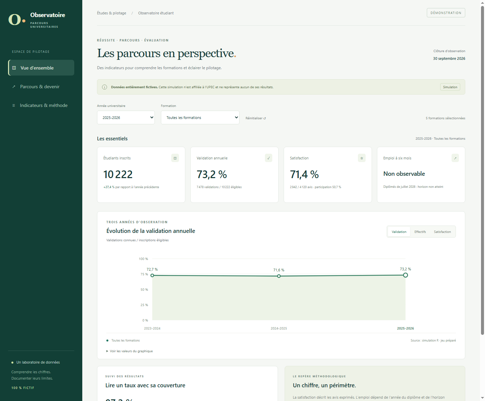

::: {.hero}
# Comprendre les parcours étudiants et éclairer le pilotage

Un projet complet d’observatoire universitaire : préparation des données, qualité, analyse des parcours, enquêtes et restitution des indicateurs.

[R · Shiny · Power BI · Quarto]{.text-muted}

[Explorer les tableaux de bord](tableaux_de_bord.qmd){.btn .btn-primary} [Lire le rapport final](rapport_final.qmd){.btn .btn-outline-secondary}
:::

::: {.callout-note}
Toutes les données sont **entièrement fictives**. Aucun chiffre ne représente un résultat réel de l’UPEC. Ce projet n’a aucune affiliation officielle avec l’établissement.
:::

## Le projet en quelques chiffres

::: {.cards}
::: {.project-card}
[10 222]{.kpi}
Inscrits dans la simulation en 2025-2026.
:::
::: {.project-card}
[73,2 %]{.kpi}
Validation annuelle parmi les inscrits éligibles.
:::
::: {.project-card}
[71,4 %]{.kpi}
Satisfaction parmi les avis exprimés.
:::
:::

## Une démarche compl’te

Le projet suit trois années universitaires et cinq formations fictives. Il relie inscriptions, résultats, parcours et enquêtes, avec des définitions documentées et des exports agrégés protégés.

[Découvrir les objectifs et la démarche →](projet.qmd)

## Explorer les résultats

[{.preview}](tableaux_de_bord.qmd)

Filtrez les données par année et formation dans le tableau de bord web, puis d’couvrez les versions Shiny et Power BI.

## Rapports et livrables {#livrables}

- [Rapport final en treize chapitres](rapport_final.qmd)
- [Note de pilotage](note_pilotage.qmd) et [PDF](note_pilotage.pdf)
- [Rapport sur les enquêtes](enquetes.qmd)
- [Présentation du projet](presentation.qmd)
- [Téléchargements et sources](livrables.qmd)
