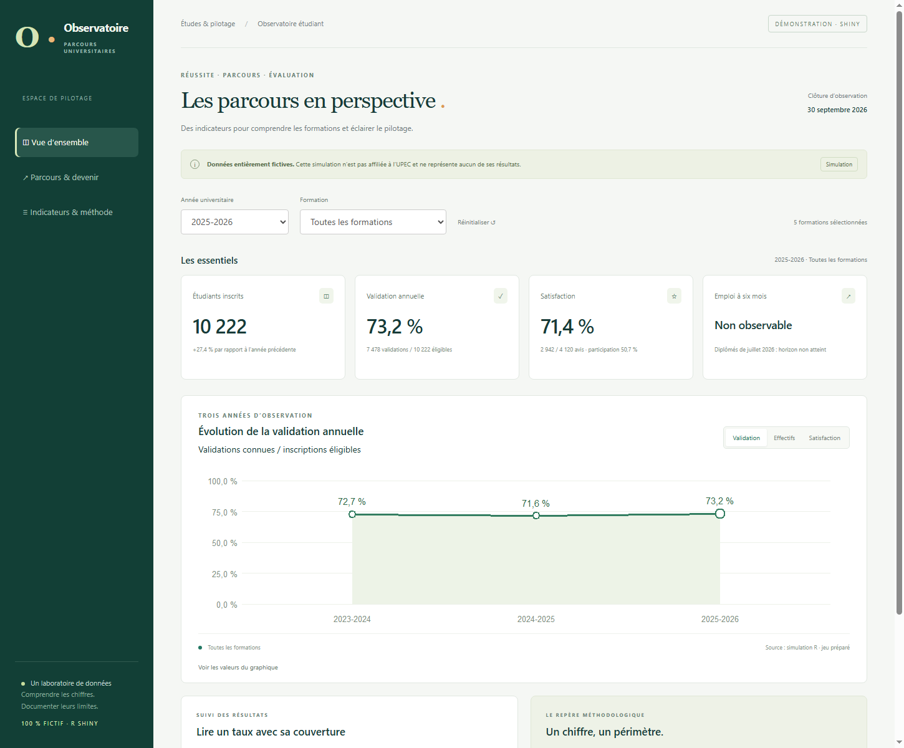

Les trois versions utilisent les mêmes exports agrégés de la simulation. Les définitions et les règles de protection sont documentées dans le rapport.

## Tableau de bord web

Filtrez par année et formation, puis parcourez les vues de synthèse, de parcours et de méthodes.

[Ouvrir en pleine page](dashboard/index.html){.btn .btn-primary}

```{=html}
<iframe class="dashboard-frame" src="dashboard/index.html" title="Tableau de bord interactif sur données fictives" loading="lazy"></iframe>
```

## Application Shiny {#shiny}

L’application R Shiny propose une exploration interactive des indicateurs. Elle se lance sur un ordinateur équipé de R ; le site statique ne peut pas exécuter son serveur.

{.preview}

[Télécharger l’application Shiny](telechargements/Observatoire_Shiny.zip){.btn .btn-outline-secondary}

Après extraction, ouvrir le projet R puis lancer :

```r
renv::restore()
source("scripts/run_shiny.R", encoding = "UTF-8")
```

## Power BI {#powerbi}

Le projet natif comprend trois pages : synthèse, parcours et méthodes, avec les données agrégées et le modèle de calcul.

[Télécharger le projet Power BI](telechargements/Observatoire_PowerBI.zip){.btn .btn-outline-secondary}

1. Extraire l’archive et ouvrir `Observatoire.pbip` dans Power BI Desktop.
2. Lire `LIRE_AVANT_OUVERTURE.md`.
3. Adapter `DossierExports` au dossier `Data/` extrait, avec un `/` final.
4. Actualiser les données.

Une publication dans Power BI Service serait nécessaire pour proposer une consultation embarquée en ligne. Le projet fourni est consultable dans Desktop.
